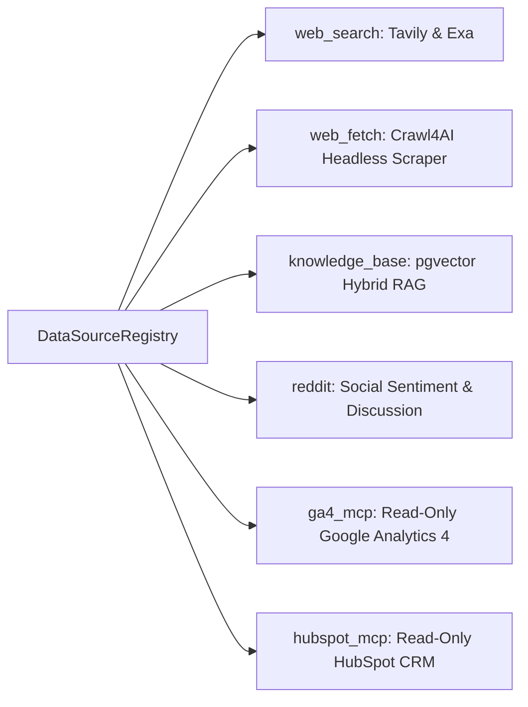
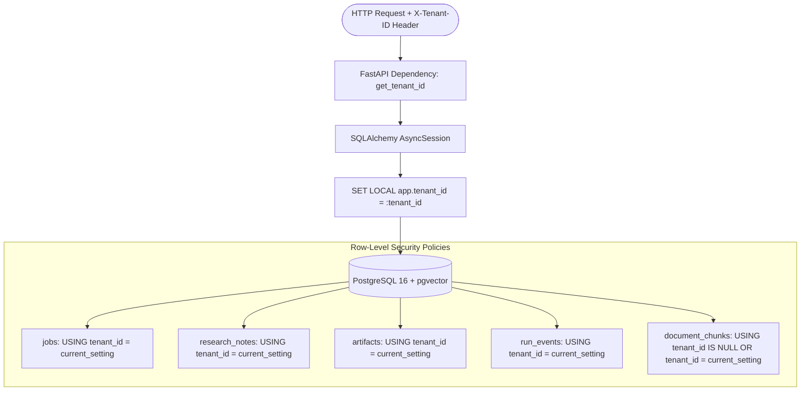
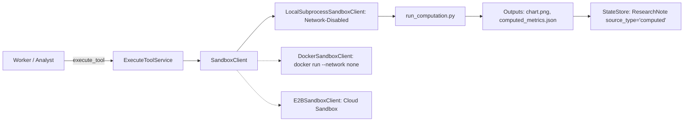

# 🔍 Deep Researcher - Multi-Agent Enterprise Research Service

A production-grade, multi-agent AI research service engineered to handle both fast lookup queries in seconds and autonomous, in-depth deep research teardowns for complex inquiries. 

The service is strictly grounded in three distinct knowledge tiers:
1. **The Public Web**: Real-time neural and keyword search (Tavily, Exa) and headless web crawling (Crawl4AI) with integrated prompt-injection sanitization.
2. **Connected Enterprise Systems**: Read-only Model Context Protocol (MCP) clients with strict allowlists for Google Analytics 4 (GA4) and HubSpot CRM.
3. **Per-Tenant Knowledge Base**: Hybrid dense (`pgvector` cosine similarity) and sparse keyword retrieval over uploaded client documents (PDF, DOCX, TXT) with PostgreSQL Row-Level Security (RLS) and shared global benchmarks.

> **Default Domain Profile**: **Marketing Agency** (competitor teardowns, campaign briefs, performance audits, and paid media KPI computations). All domain behaviors reside in configuration files (`config/`) and modular skills (`skills/`), ensuring core agent logic remains domain-agnostic.

---

## 📑 Table of Contents
- [Architecture & Core Workflow](#-architecture--core-workflow)
  - [High-Level Architectural Topology](#high-level-architectural-topology)
  - [Complete 13-Stage Workflow](#complete-13-stage-workflow)
  - [State Machine & Graph State Schema](#state-machine--graph-state-schema)
- [Agentic Subsystems & Components](#-agentic-subsystems--components)
- [Data Sources & MCP Integration Layer](#-data-sources--mcp-integration-layer)
- [Multi-Tenancy, Storage & Database Architecture](#-multi-tenancy-storage--database-architecture)
- [Sandboxed Code Execution & Skills Runtime](#-sandboxed-code-execution--skills-runtime)
- [Quality Gates & Guardrails](#-quality-gates--guardrails)
- [Observability, Telemetry & Cost Control](#-observability-telemetry--cost-control)
- [Interactive Gradio Visualizer](#-interactive-gradio-visualizer)
- [API Reference & Server-Sent Events (SSE)](#-api-reference--server-sent-events-sse)
- [Repository Structure & File Map](#-repository-structure--file-map)
- [Getting Started & Local Setup](#-getting-started--local-setup)
- [Verification & Test Suite](#-verification--test-suite)

---

## 🏗️ Architecture & Core Workflow

### High-Level Architectural Topology

```mermaid
graph TD
    User([User Request / Query]) --> API[FastAPI Gateway: /v1/jobs]
    API --> SSE[SSE Event Stream: /v1/jobs/{id}/events]
    API --> Graph[LangGraph State Machine Engine]

    subgraph Phase 1: Ingestion & Routing
        Graph --> Classifier[1. Intent Classifier: Groq Fast Role]
        Classifier -->|Chit-Chat| ChitChat[Direct Conversational Reply]
        Classifier -->|Shallow Mode| Shallow[2. Shallow Research Loop: Max 6 Tools]
        Classifier -->|Deep / Ambiguous| Clarify[3. HITL Clarifier: LangGraph Interrupt]
        Clarify -.->|User Resumes /v1/jobs/{id}/clarify| Router[4. Source Router]
        Classifier -->|Deep Mode| Router
        Shallow -->|Complex Query / Budget Exceeded| Router
    end

    subgraph Phase 2: Planning & Orchestrated Execution
        Router --> Planner[5. Planner Agent: Gemini Strong Role]
        Planner --> Orchestrator[6. Research Orchestrator: Concurrency Cap 4]
        
        Orchestrator --> Worker1[7. Concurrent Worker: Entity 1]
        Orchestrator --> Worker2[7. Concurrent Worker: Entity 2]
        Orchestrator --> Worker3[7. Concurrent Worker: Entity 3]
        
        Worker1 --> Tools[(Web Search / Crawl4AI / MCP / pgvector)]
        Worker2 --> Tools
        Worker3 --> Tools

        Worker1 --> StateStore[(8. Shared StateStore: PostgreSQL RLS)]
        Worker2 --> StateStore
        Worker3 --> StateStore
    end

    subgraph Phase 3: Verification & Quantitative Analysis
        StateStore --> Verifier[9. Gap Check Verifier: Max 1 Extra Round]
        Verifier -->|Gaps Found| Orchestrator
        Verifier -->|Notes Complete| Analyst[10. Analyst Agent: Sandboxed Execution]
        Analyst --> Sandbox[Code Interpreter: Pandas & Matplotlib Sandbox]
        Sandbox --> StateStore
    end

    subgraph Phase 4: Synthesis, Guardrails & Delivery
        StateStore --> Writer[11. Writer Agent: Cites Notes Inline]
        Writer --> CitGate[12. Citation Gate: Audits Quantitative Claims]
        CitGate --> CompGate[12. Compliance Gate: Global & Tenant Rules]
        CompGate --> Deliver[13. Delivery Node: PPTX Deck & MinIO Upload]
        Deliver --> Artifacts[(MinIO S3 Object Storage)]
        Deliver --> Completed([Job Completed: Final Report & Slides])
    end

    Completed -.-> FollowUp[14. Report Follow-Up Engine: /v1/jobs/{id}/followup]
```

---

### Complete 13-Stage Workflow

1. **Intent Classifier (`core/agents/classifier.py`)**:
   - Single fast-model invocation (`Groq Llama-3.3-70b-versatile` or `Llama-3.1-8b-instant`).
   - Categorizes queries into `shallow`, `deep`, `clarify`, or `chit_chat` with confidence scoring.
   - Heuristic fallback prevents classification failures if upstream model APIs encounter transient timeouts.

2. **Shallow Research Loop (`core/agents/shallow.py`)**:
   - Fast lookup loop bounded to a maximum of 6 tool calls across web search and knowledge retrieval.
   - Evaluates query complexity: if the query requires multi-entity comparison, competitor teardown, or campaign analysis, it automatically escalates to the deep research workflow (`escalated_to_deep`).
   - Returns a concise answer citing verified notes.

3. **Human-In-The-Loop (HITL) Clarification (`core/agents/clarifier.py`)**:
   - For ambiguous deep requests, probes missing brief dimensions: **Target Audience**, **Geography**, **Goal/KPI**, **Budget**, **Brand Voice**, and **Named Competitors**.
   - Uses LangGraph `interrupt(payload)` to freeze execution state and persist thread checkpoints to disk.
   - Resumed seamlessly via `POST /v1/jobs/{id}/clarify` using `Command(resume=...)`.

4. **Source Router (`core/agents/source_router.py`)**:
   - Inspects active sources in `DataSourceRegistry` (`web_search`, `web_fetch`, `knowledge_base`, `reddit`, `ga4_mcp`, `hubspot_mcp`).
   - Dynamically selects optimal sources per task based on task goals and available tenant credentials.

5. **Planner Agent (`core/agents/planner.py`)**:
   - Strong reasoning model (`Gemini 2.5 Flash` or `Gemini 1.5 Pro`) constructs a structured `Plan` containing up to 8 granular `PlanTask` items.
   - Each task defines `task_id`, `objective`, `entity`, `source_hints`, `expected_output` (`notes` | `notes+table` | `notes+chart`), and explicit dependencies (`depends_on`).

6. **Research Orchestrator (`core/agents/orchestrator.py`)**:
   - Resolves task dependencies via a directed acyclic task graph.
   - Dispatches tasks concurrently to a worker pool with a strict concurrency ceiling (default: 4 concurrent workers).

7. **Concurrent Researcher Workers (`core/agents/worker.py`)**:
   - Workers execute search, crawling, internal document retrieval, and MCP queries.
   - **Contract Guarantee**: Workers never return free text. Every finding is committed as a structured `ResearchNote {id, job_id, claim, source_type, source_url, document_id, excerpt, confidence, task_id}`.
   - Enforces a hard budget cap of 8 tool calls and 90 seconds timeout per worker.
   - Automatically tags notes as `source_type="fallback"` and emits `provider_fallback` events if third-party providers are unreachable.

8. **Shared Research State (`core/state/store.py`)**:
   - Centralized persistence layer managing `jobs`, `research_notes`, `artifacts`, and `run_events`.
   - Multi-tenant Row-Level Security (RLS) guarantees zero cross-tenant query contamination.
   - Dual-engine: PostgreSQL 16 with `pgvector` for production; SQLite + `aiosqlite` for fast, isolated test suites.

9. **Gap Check Verifier (`core/agents/verifier.py`)**:
   - Audits gathered notes against the initial plan and identifies missing entities or unverified claims.
   - Injects at most one bounded extra round of research tasks if critical gaps exist; routes forward if satisfied.

10. **Analyst Agent & Execution Sandbox (`core/agents/analyst.py`, `core/sandbox/client.py`)**:
    - Invoked for tasks requiring quantitative precision, tables, or charts.
    - Executes Python code in a network-isolated sandbox (`LocalSubprocessSandboxClient`, `DockerSandboxClient`, or `E2BSandboxClient`).
    - Produces clean PNG charts (`chart.png`), summary JSON files, and registers derived metrics as `ResearchNote(source_type="computed")`.

11. **Writer Agent (`core/agents/writer.py`)**:
    - Synthesizes findings exclusively from verified notes and computed artifacts.
    - Injects mandatory inline citations in the format `[note_...]`.
    - If fallback notes are detected, automatically prepends a prominent warning banner: `> [!WARNING] **Notice: Provider Fallback Active**`, annotating references with `(FALLBACK [SIMULATED DATA])`.

12. **Quality & Compliance Gates (`core/guardrails/`)**:
    - **Citation Gate (`citation_gate.py`)**: Audits every quantitative assertion (numbers, percentages, currencies) and comparative claim, verifying that every citation matches a valid note ID.
    - **Compliance Gate (`compliance_gate.py`)**: Loads rules from `config/compliance/` (unsubstantiated ROI, competitor disparagement, confidential data leakage). Triggers one automatic rewrite loop on high-severity findings; persistent violations halt delivery and flag for human review.

13. **Delivery Node & PPTX Engine (`core/tools/pptx_generator.py`, `core/storage/minio_client.py`)**:
    - Uploads final markdown reports, PNG charts, and computation scripts to MinIO S3 object storage.
    - Auto-generates an executive presentation deck (`.pptx`) with max 5 bullets per slide and zero empty placeholders.
    - Emits a final `done` event via SSE.

14. **Grounded Report Follow-up (`core/agents/followup.py`)**:
    - Dedicated endpoint (`POST /v1/jobs/{id}/followup`) enabling users to ask follow-up questions or request brief revisions.
    - Grounded exclusively in the existing report and notes without re-triggering costly multi-agent research loops.

---

### State Machine & Graph State Schema

The core workflow runs as a compiled `StateGraph(ResearchGraphState)` with persistent SQLite/PostgreSQL checkpointing:

```python
class ResearchGraphState(TypedDict, total=False):
    job_id: str
    tenant_id: str
    query: str
    mode: str                          # "shallow" | "deep" | "clarify" | "chit_chat"
    confidence: float
    stage: str
    brief: Optional[Dict[str, Any]]
    selected_sources: List[str]
    plan: Optional[Dict[str, Any]]
    notes: Annotated[List[Dict[str, Any]], merge_notes]
    artifacts: Annotated[List[Dict[str, Any]], merge_artifacts]
    input_files: Dict[str, bytes]
    report: Optional[str]
    citations: List[str]
    clarification_needed: bool
    clarification_questions: List[str]
    clarification_response: Optional[str]
    followup_query: Optional[str]
    followup_response: Optional[str]
    budget: Dict[str, Any]
    budget_warning: bool
    budget_exhausted: bool
    extra_research_rounds: int
    extra_research_done: bool
    gate_passed: bool
    gate_issues: List[Dict[str, Any]]
    compliance_passed: bool
    compliance_issues: List[str]
    delivered_artifacts: List[Dict[str, Any]]
    done: bool
    error: Optional[str]
```

---

## 🤖 Agentic Subsystems & Components

| Agent / Component | Primary Model Role | Source File | Core Responsibilities & Output Contract |
|---|---|---|---|
| **Intent Classifier** | Fast (`Llama 3.3 70B`) | `core/agents/classifier.py` | Routes incoming query into `shallow`, `deep`, `clarify`, or `chit_chat`. |
| **Shallow Researcher** | Fast (`Llama 3.3 70B`) | `core/agents/shallow.py` | Bounded tool execution (max 6 calls); auto-escalates complex queries to deep mode. |
| **HITL Clarifier** | Strong (`Gemini 2.5 Flash`) | `core/agents/clarifier.py` | Probes brief dimensions; triggers LangGraph `interrupt()`; resumes with brief. |
| **Source Router** | Fast (`Llama 3.3 70B`) | `core/agents/source_router.py` | Assigns active data sources from `DataSourceRegistry` per task. |
| **Planner Agent** | Strong (`Gemini 2.5 Flash`) | `core/agents/planner.py` | Decomposes deep research into max 8 dependent `PlanTask` items with entity targets. |
| **Research Orchestrator** | Deterministic Async | `core/agents/orchestrator.py` | Dispatches tasks to worker pool with concurrency cap (4) and dependency gating. |
| **Research Workers** | Fast (`Llama 3.3 70B`) | `core/agents/worker.py` | Executes search/fetch/MCP; returns strictly structured `ResearchNote` items. |
| **Gap Check Verifier** | Strong (`Gemini 2.5 Flash`) | `core/agents/verifier.py` | Audits notes against plan; schedules at most one extra round of research tasks. |
| **Analyst Agent** | Deterministic Sandbox | `core/agents/analyst.py` | Executes pandas/matplotlib scripts; computes exact KPIs; saves charts & computed notes. |
| **Writer Agent** | Strong (`Gemini 2.5 Flash`) | `core/agents/writer.py` | Composes comprehensive executive teardown; enforces inline note citations & fallback alerts. |
| **Citation Gate** | Deterministic Regex | `core/guardrails/citation_gate.py` | Audits all quantitative, percentage, currency, and superlative claims against note IDs. |
| **Compliance Gate** | Deterministic / LLM | `core/guardrails/compliance_gate.py` | Enforces global & tenant compliance rules; triggers auto-rewrite on violations. |
| **Delivery Engine** | Deterministic PPTX | `core/tools/pptx_generator.py` | Builds PowerPoint decks with 5-bullet rule; uploads report & slides to MinIO. |
| **Follow-Up Agent** | Strong (`Gemini 2.5 Flash`) | `core/agents/followup.py` | Answers post-report queries grounded strictly in verified notes and final report. |

---

## 🔌 Data Sources & MCP Integration Layer

The service features a dynamic `DataSourceRegistry` conforming to the `DataSource` protocol in `core/tools/registry.py`:



### Supported Data Sources

1. **Web Search (`core/tools/search.py`)**:
   - **Tavily Search**: Real-time neural query execution via `AsyncTavilyClient`.
   - **Exa Search**: Semantic embeddings search via `exa_py.Exa`.
   - **Fallback Protection**: Graceful fallback with automatic metadata tagging (`is_fallback=True`, `source_type="fallback"`).
2. **Web Page Fetcher (`core/tools/fetch.py`)**:
   - Headless scraping via `crawl4ai.AsyncWebCrawler` (with `httpx` fallback).
   - Anti-prompt injection filtering and sanitization. Content wrapped in `<untrusted_data>` XML blocks.
3. **Tenant Knowledge Base (`core/knowledge/`)**:
   - Supports PDF, DOCX, and TXT parsing via `DocumentParser`.
   - Chunking: ~800 tokens with 100-token overlap (`RecursiveTokenChunker`).
   - Dense Embeddings: `SentenceTransformerEmbedder` (`all-MiniLM-L6-v2`, 384 dimensions).
   - Hybrid Retrieval: Combined vector similarity (0.7 weight) and keyword BM25/trigram (0.3 weight).
4. **Read-Only Model Context Protocol (MCP) Wrappers (`core/tools/mcp_wrapper.py`)**:
   - Integrates `langchain-mcp-adapters` with strict allowlists preventing write mutations.
   - **GA4 Allowlist**: `run_report`, `get_metadata`, `run_realtime_report`.
   - **HubSpot Allowlist**: `search_companies`, `get_company`, `search_deals`, `get_deal`, `search_contacts`.
   - Any mutation tool (e.g. `create_contact`, `delete_deal`) raises an explicit `PermissionError`.

---

## 🗄️ Multi-Tenancy, Storage & Database Architecture

Multi-tenancy is enforced from the HTTP gateway down to database rows:



### Database Schema Highlights (`db/schema.sql`)
- **`jobs`**: Job status, brief JSON, plan JSON, final report markdown, and budget tracking state.
- **`research_notes`**: Atomic claims, source types (`web`, `kb`, `mcp`, `computed`, `fallback`), source URLs, excerpts, and task IDs.
- **`artifacts`**: Scripts, PNG charts, CSV files, reports, and presentation decks.
- **`run_events`**: Audit log of all SSE events emitted during job lifecycle.
- **`documents` & `document_chunks`**: Document text and 384-dimensional vector embeddings with cosine similarity IVFFlat index.
- **Shared Benchmark Namespace**: Chunks with `tenant_id = NULL` represent global industry benchmarks readable by all tenants but writable only by administrators.
- **LangGraph Checkpointing**: Checkpoints persisted via `AsyncSqliteSaver` on `checkpoints.db` (or `AsyncPostgresSaver` in cluster deployments), surviving process crashes mid-interrupt.

---

## 🧪 Sandboxed Code Execution & Skills Runtime

To eliminate hallucinated metrics and incorrect calculations, the system delegates numerical computations to a sandboxed Python interpreter.



### Modular Skills Catalog (`/skills/`)
Skills are modular instructions with YAML frontmatter mounted by agent role:

- `skills/chart_generation/SKILL.md` (`role: analyst`): Generates publication-ready matplotlib charts (300 DPI, minimalist whitegrid styling).
- `skills/competitor_matrix/SKILL.md` (`role: analyst`): Builds multi-dimensional comparison tables comparing 3+ market rivals across pricing and features.
- `skills/data_table_analysis/SKILL.md` (`role: analyst`): Deterministically computes CTR, CPC, CPA, ROAS, and conversion rates from raw CSV datasets.
- `skills/pptx_from_template/SKILL.md` (`role: writer`): Generates PowerPoint slide decks with a strict 5-bullet ceiling per slide and zero empty placeholders.
- `skills/report_writer/SKILL.md` (`role: writer`): Synthesizes research notes into executive teardowns with mandatory inline citation tags.

---

## 🛡️ Quality Gates & Guardrails

### 1. Citation Gate (`core/guardrails/citation_gate.py`)
- Audits final reports using regex pattern matching:
  - Quantitative metrics (e.g. `2.375%`, `$13,700`, `19,000 clicks`).
  - Comparative claims (e.g. `higher than`, `outperformed`, `cheapest`).
  - Superlatives (e.g. `fastest`, `leading`, `highest ROAS`).
- Verifies that every quantitative statement carries a valid citation tag `[note_...]` linking to an existing `ResearchNote` ID in the job's research store.
- Strips or sanitizes orphaned citations.

### 2. Compliance Gate (`core/guardrails/compliance_gate.py`)
- Evaluates reports against global rules (`config/compliance/global_rules.yaml`) and tenant-specific rules (`config/compliance/tenant_rules.yaml`).
- Enforces strict standards:
  - Banned unsubstantiated ROI claims (e.g. *"guaranteed 10x ROI"*).
  - Banned competitor disparagement (e.g. *"competitor X is obsolete and broken"*).
  - Leakage of internal tenant confidential data.
- Executes an automated single-round rewrite loop. If persistent violations remain, blocks delivery and flags the job for human supervisor review.

### 3. Prompt Injection Defense (`core/guardrails/injection.py`)
- Analyzes scraped web content and third-party API data for adversarial phrases (`ignore previous instructions`, `system override`, `developer mode`).
- Sanitizes suspicious content and encapsulates external data inside `<untrusted_data>` XML fences to prevent prompt jailbreaks.

---

## 📊 Observability, Telemetry & Cost Control

### 1. Langfuse Tracing (`core/observability/tracing.py`)
- Centralized distributed tracing via the Langfuse 5.x SDK.
- Decorators `@trace_agent("agent_name")` and `@trace_tool("tool_name")` track:
  - Inputs and outputs.
  - Step latencies and timestamps.
  - LLM token usage and execution errors.
- Graceful no-op fallback when Langfuse credentials are not provided or the service is offline.

### 2. Hard Per-Run Budget Ceilings
- Tracked per job in `BudgetState {max_steps, max_search_queries, max_cost_usd, current_steps, current_search_queries}`.
- **80% Usage**: Emits a `budget_warning` event onto the SSE stream so user interfaces can display a warning badge.
- **100% Usage**: Triggers an immediate, graceful clean stop. Remaining worker tasks are bypassed, and the workflow routes directly to the Writer Agent to synthesize existing notes into a partial, well-grounded report.

---

## 🖥️ Interactive Gradio Visualizer

In addition to the headless FastAPI service, the repository provides an interactive research visualizer in `app.py`:

```bash
python app.py
```

### Visualizer Features
- **Live Query & Evidence Tracker**: Real-time visualization of search queries dispatched and results returned.
- **Domain Source Badges**: Color-coded badges indicating public web, internal KB, or connected MCP sources.
- **Reflection & Critique Cards**: Visual reflection cards displaying agent critique, missing information, and knowledge gaps.
- **Interactive Markdown Renderer**: Rich rendering of synthesized teardowns with clickable source links.

---

## 📡 API Reference & Server-Sent Events (SSE)

All API endpoints are scoped per tenant via the `X-Tenant-ID` header.

### Endpoints Overview

| Method | Endpoint | Description | Request Body |
|---|---|---|---|
| `POST` | `/v1/jobs` | Create new research job | `{"query": "...", "mode": "deep"}` |
| `GET` | `/v1/jobs/{job_id}` | Poll job details and final report | _None_ |
| `GET` | `/v1/jobs/{job_id}/events` | Real-time SSE event stream | _None_ |
| `POST` | `/v1/jobs/{job_id}/clarify` | Resume job with brief clarification answers | `{"response": "...", "audience": "..."}` |
| `POST` | `/v1/jobs/{job_id}/followup` | Ask grounded follow-up question | `{"query": "..."}` |
| `GET` | `/v1/jobs/{job_id}/artifacts` | List produced artifacts (deck, charts, scripts) | _None_ |
| `POST` | `/v1/tenants/{tenant_id}/documents` | Upload PDF/DOCX to tenant knowledge base | `multipart/form-data: file=@doc.pdf` |

---

### Real-Time SSE Event Types

Subscribing to `/v1/jobs/{job_id}/events` streams real-time JSON events:

| Event Type | Payload Attributes | Emitted When |
|---|---|---|
| `stage_started` | `{"stage": "planner"}` | An agent or workflow node starts execution. |
| `tool_call` | `{"tool": "tavily_search", "query": "..."}` | A researcher worker or sandbox executes a tool. |
| `note_added` | `{"note_id": "note_123", "claim": "..."}` | A verified `ResearchNote` is saved to StateStore. |
| `clarification_needed` | `{"interrupt": {...questions}}` | HITL Clarifier pauses execution waiting for user brief. |
| `provider_fallback` | `{"provider": "exa", "reason": "..."}` | An external provider fails and fallback data is tagged. |
| `budget_warning` | `{"pct_used": 0.85}` | Job exceeds 80% of step or query budget. |
| `gate_flagged` | `{"gate": "compliance", "violations": [...]}` | Citation or Compliance gate flags an issue. |
| `artifact_ready` | `{"artifact_type": "presentation", "file_path": "..."}` | PPTX, chart, or report artifact is persisted. |
| `done` | `{"report_preview": "...", "delivered_count": 2}` | Job completes and all artifacts are uploaded. |
| `error` | `{"error": "..."}` | An unhandled exception halts workflow execution. |

---

## 📂 Repository Structure & File Map

```text
deep-research-agent/
├── apps/
│   └── api/
│       ├── dependencies.py          # Tenant resolution, StateStore & ModelRouter DI
│       └── main.py                  # FastAPI gateway, SSE streaming & endpoints
├── config/
│   ├── compliance/
│   │   ├── global_rules.yaml        # Global compliance guardrails (unsubstantiated claims)
│   │   └── tenant_rules.yaml        # Tenant-specific competitor & disclosure rules
│   ├── models.yaml                  # Dynamic model routing (Groq vs Gemini assignments)
│   └── search.yaml                  # Search provider weighting & query parameters
├── core/
│   ├── agents/
│   │   ├── analyst.py               # Quantitative analysis agent executing sandboxed code
│   │   ├── clarifier.py             # HITL brief clarifier with LangGraph interrupt
│   │   ├── classifier.py            # Fast query intent classifier
│   │   ├── followup.py              # Grounded post-report Q&A agent
│   │   ├── orchestrator.py          # Parallel research orchestrator with concurrency pool
│   │   ├── planner.py               # Plan decomposition agent creating tasks & dependencies
│   │   ├── shallow.py               # Fast bounded shallow lookup loop
│   │   ├── source_router.py         # Dynamic source selector against registry
│   │   ├── verifier.py              # Gap check verifier scheduling extra research
│   │   ├── worker.py                # Research worker returning structured ResearchNotes
│   │   └── writer.py                # Executive report writer with inline citations
│   ├── graph/
│   │   ├── builder.py               # Complete LangGraph StateGraph assembly & wiring
│   │   └── state.py                 # ResearchGraphState definition & reducer functions
│   ├── guardrails/
│   │   ├── citation_gate.py         # Quantitative & comparative claim citation gate
│   │   ├── compliance_gate.py       # Global & tenant compliance rule engine
│   │   └── injection.py             # Prompt injection defense & XML untrusted data fencing
│   ├── knowledge/
│   │   ├── chunker.py               # Recursive token chunker (~800 tokens, 100 overlap)
│   │   ├── embedder.py              # SentenceTransformer 384-dimensional dense embedder
│   │   ├── parser.py                # PDF, DOCX, and TXT document extractor
│   │   └── store.py                 # pgvector hybrid search (vector 0.7 + keyword 0.3)
│   ├── models/
│   │   └── router.py                # Centralized ModelRouter (Groq & Gemini providers)
│   ├── observability/
│   │   └── tracing.py               # Langfuse 5.x distributed tracing & latency decorators
│   ├── sandbox/
│   │   └── client.py                # LocalSubprocess, Docker & E2B sandbox interpreters
│   ├── state/
│   │   ├── models.py                # SQLAlchemy ORM models with RLS policies
│   │   ├── schemas.py               # Pydantic v2 schemas (Job, Plan, ResearchNote, Artifact)
│   │   └── store.py                 # Thread-safe multi-tenant StateStore & SSE broadcast
│   ├── storage/
│   │   └── minio_client.py          # MinIO / S3 object storage client
│   └── tools/
│       ├── execute_tool.py          # Execution service saving scripts & computed notes
│       ├── fetch.py                 # Headless Crawl4AI scraper with anti-injection
│       ├── mcp_wrapper.py           # Read-only MCP client for GA4 & HubSpot
│       ├── pptx_generator.py        # Editable PowerPoint slide generator
│       ├── registry.py              # DataSourceRegistry & DataSource protocol
│       └── search.py                # Multi-provider search (Tavily, Exa, fallbacks)
├── db/
│   ├── init.sql                     # Postgres database bootstrapping
│   └── schema.sql                   # Production DDL with Row-Level Security & pgvector
├── evals/
│   ├── datasets/
│   │   └── marketing_benchmark_eval.json  # Benchmark evaluation test cases
│   └── runners/
│       └── eval_runner.py           # Offline evaluation runner (accuracy & citations)
├── infra/
│   ├── Dockerfile                   # Production Python 3.12 container definition
│   └── docker-compose.yml           # Multi-service stack (Postgres, MinIO, Langfuse, API)
├── skills/
│   ├── chart_generation/SKILL.md    # Matplotlib chart generator skill
│   ├── competitor_matrix/SKILL.md   # Multi-competitor feature/pricing matrix skill
│   ├── data_table_analysis/SKILL.md # Deterministic pandas KPI calculation skill
│   ├── pptx_from_template/SKILL.md  # Editable presentation deck layout skill
│   └── report_writer/SKILL.md       # Note-grounded synthesis writer skill
├── tests/
│   ├── mocks.py                     # Deterministic mock LLM for fast offline testing
│   ├── test_budgets_security_evals.py # Budget clean stop & prompt injection tests
│   ├── test_deep_planner_workers.py   # Multi-competitor teardown & worker pool tests
│   ├── test_end_to_end_pipeline.py    # Complete end-to-end integration pipeline test
│   ├── test_gap_writer_followup.py    # Gap check verifier & post-report follow-up tests
│   ├── test_live_smoke.py             # Live smoke tests for Groq, Gemini, Tavily, MCP
│   ├── test_pptx_compliance_mcp.py    # Slide layout, compliance gate & read-only MCP tests
│   ├── test_sandbox_analysis.py       # Isolated sandbox code execution & chart tests
│   ├── test_scaffold.py               # API endpoints, SSE streaming & crash resumption tests
│   ├── test_shallow_citation.py       # Intent classifier & 20-lookup benchmark tests
│   └── test_tenancy_knowledge.py      # Tenant isolation & zero-leakage RLS tests
├── app.py                           # Interactive Gradio research visualizer
├── DECISIONS.md                     # Architectural audit log, decisions & test records
└── README.md                        # Primary architectural & operational documentation
```

---

## 🚀 Getting Started & Local Setup

### 1. Prerequisites
- Python 3.11 or 3.12
- Docker & Docker Compose (optional for full containerized stack)
- API Keys:
  - `GROQ_API_KEY`: Fast model roles (Classifier, Shallow Agent, Research Workers)
  - `GEMINI_API_KEY`: Strong model roles (HITL Clarifier, Planner, Verifier, Writer, Follow-up)
  - `TAVILY_API_KEY`: Real-time public web search
  - `EXA_API_KEY` (optional): Neural web search
  - `E2B_API_KEY` (optional): Cloud sandboxed code execution

### 2. Environment Configuration
Copy `.env.example` to `.env`:
```bash
cp .env.example .env
```
Populate your credentials in `.env`.

### 3. Running with Docker Compose (Recommended)
Launch the entire containerized infrastructure (PostgreSQL 16 with `pgvector`, MinIO Object Storage, Langfuse Observability, and FastAPI Application):
```bash
docker compose -f infra/docker-compose.yml up --build
```
The FastAPI Gateway will be available at `http://localhost:8000`.

### 4. Running Locally

```bash
# 1. Create and activate virtual environment
python -m venv venv
source venv/bin/activate       # On Windows: .\venv\Scripts\activate

# 2. Install dependencies
pip install -r requirements.txt

# 3. Launch FastAPI Server
uvicorn apps.api.main:app --host 0.0.0.0 --port 8000 --reload

# 4. (Optional) Launch Interactive Gradio Visualizer
python app.py
```

---

## 🧪 Verification & Test Suite

The repository includes a comprehensive automated test suite spanning unit tests, security guardrails, multi-tenant isolation verification, and end-to-end multi-agent pipelines:

```bash
# Run full test suite
python -m pytest -v
```

### Key Test Modules

| Test Module | Coverage & Verification Scope |
|---|---|
| `tests/test_scaffold.py` | API endpoints, SSE event streaming, SQLite checkpointing, and process crash recovery. |
| `tests/test_tenancy_knowledge.py` | PostgreSQL Row-Level Security (RLS), 30 probing queries with zero cross-tenant leakage, unset tenant isolation, document chunking & parsing. |
| `tests/test_shallow_citation.py` | Intent classification, 20-lookup factual benchmark, and strict citation gate validation. |
| `tests/test_deep_planner_workers.py` | Multi-competitor teardown, dynamic task dependency resolution, and parallel worker orchestration. |
| `tests/test_gap_writer_followup.py` | Verifier gap check, note citation coverage audit, and post-report follow-up engine. |
| `tests/test_sandbox_analysis.py` | Network-isolated sandbox execution, deterministic CSV KPI calculations, and chart generation. |
| `tests/test_pptx_compliance_mcp.py` | PowerPoint layout rules (max 5 bullets, zero empty placeholders), compliance gate violations, and read-only MCP allowlisting. |
| `tests/test_budgets_security_evals.py` | 80% warning & 100% clean stop budget limits, prompt injection defenses, and offline evaluation suite. |
| `tests/test_end_to_end_pipeline.py` | Complete end-to-end integration test: vague request -> clarify -> plan -> parallel research -> CSV analysis -> synthesis -> quality gates -> MinIO artifact upload. |
| `tests/test_phase7_acceptance.py` | 8-point acceptance suite verifying 18 vertical adapters, RRF merge, SimHash dedup, robots.txt/rate-limits/circuit-breakers, exact location excerpts, Chrome fragment URLs, fan-out seen-URL dedup, and tenant isolation. |
| `tests/test_live_smoke.py` | Live integration smoke suite testing real Groq, Gemini, Tavily, Crawl4AI, and MCP connections. |
| `tests/test_live_searxng.py` | Live SearXNG query execution, health checks, and engine federation. |
