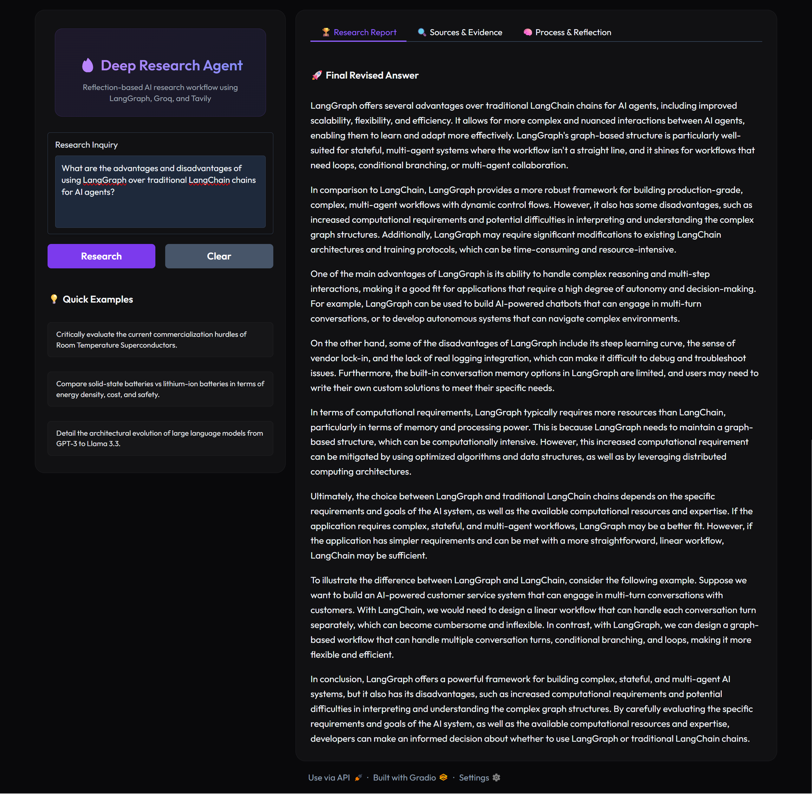
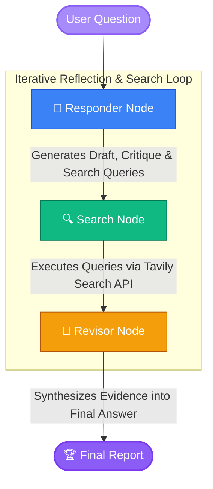

# 🔍 Deep Research Agent

<p align="center">
  
  
  
  
  
</p>

An advanced, reflection-based AI research workflow built using **LangGraph**, **Groq LLM**, and **Tavily Search**. The agent iteratively audits its initial drafts using self-reflection critique loops, performs targeted parallel web searches to retrieve missing facts, and synthesizes evidence into an accurate, high-fidelity final report.

Featuring a premium, custom-styled dark-mode **Gradio** dashboard workspace.

---

## 🌟 Key Features

* **Iterative Self-Reflection Critique**: The responder agent critically evaluates its own initial answers to identify *missing information* and *unnecessary clutter*.
* **Targeted Query Generation**: Dynamically formulates multiple distinct search queries tailored to fill information gaps.
* **Parallel Tavily Search**: Executes search queries concurrently across the web to gather factual evidence and source citations.
* **Fact-Backed Synthesis**: A revisor agent resolves gaps and combines the original answer with verified web search results into a clean markdown report.
* **Sleek Side-by-Side Dashboard**:
  - **Inquiry Sidebar**: A convenient column to input prompts and access **Quick Examples** with single-click population.
  - **Sources & Evidence Tab**: Beautiful, custom HTML-styled source cards featuring domain badges and direct URLs.
  - **Process & Reflection Tab**: Step-by-step look under the hood (Initial Draft $\rightarrow$ Critique Alerts $\rightarrow$ Formulated Queries).

---

## 🖼️ Application Interface

Here are a few screenshots showcasing the premium dark-themed Gradio dashboard in action:

### 🏆 Final Research Report & Workspace


### 🔍 Gathered Web Evidence & Source Cards


### 🧠 Under-the-hood Process & Reflection Accordeon


---

## 📐 System Architecture

The workflow is modeled as a compiled **LangGraph** State Machine:



---

## 🚀 Getting Started

### Prerequisites

- Python 3.9 or higher
- Groq API Key (using `llama-3.3-70b-versatile` by default)
- Tavily API Key

### Installation

1. **Clone the repository**:
   ```bash
   git clone https://github.com/Dakshin10/deep-research-agent.git
   cd deep-research-agent
   ```

2. **Create and activate a virtual environment**:
   ```bash
   # On Windows
   python -m venv venv
   venv\Scripts\activate
   
   # On macOS/Linux
   python3 -m venv venv
   source venv/bin/activate
   ```

3. **Install dependencies**:
   ```bash
   pip install -r requirements.txt
   ```

4. **Set up environment variables**:
   Create a `.env` file in the root directory (or copy `.env.example`):
   ```ini
   GROQ_API_KEY=your_groq_api_key_here
   TAVILY_API_KEY=your_tavily_api_key_here
   ```

### Running the App

Launch the local Gradio dashboard server:
```bash
python app.py
```

Open your browser and navigate to the local server URL (usually **`http://127.0.0.1:7860`**).

---

## 📁 Repository Structure

```
├── agents/             # Agent definitions (responder, revisor)
├── graph/              # LangGraph workflow state configuration
├── prompts/            # Prompt templates for LLM reasoning
├── schemas/            # Structured output Pydantic schemas
├── tools/              # Tavily Search API wrapper tool
├── app.py              # Main dashboard frontend and application logic
└── .env                # Secret keys (ignored by Git)
```
